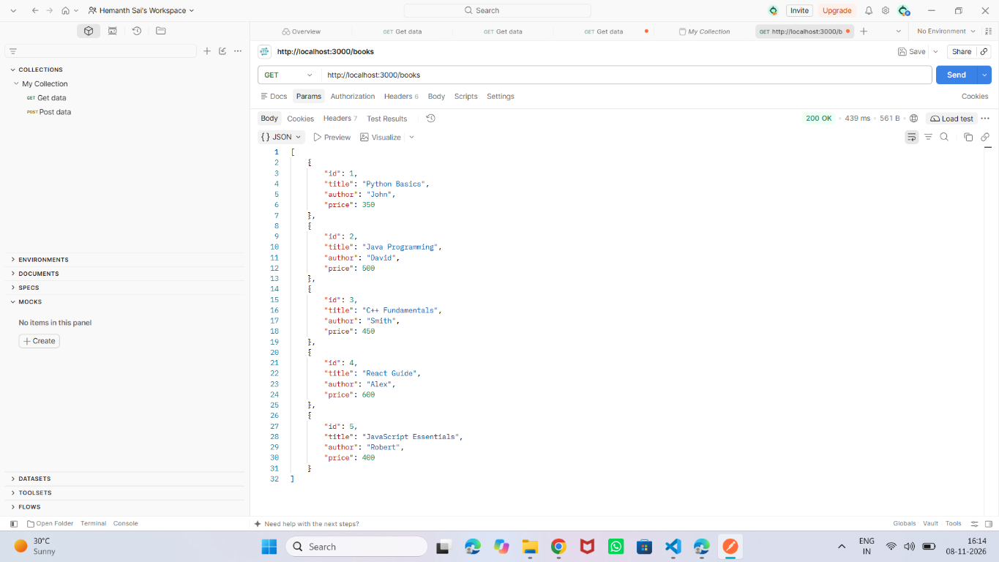
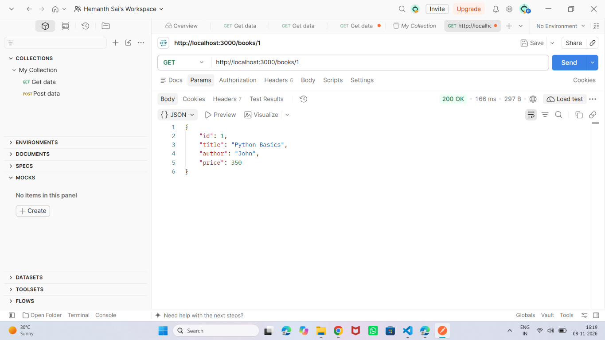
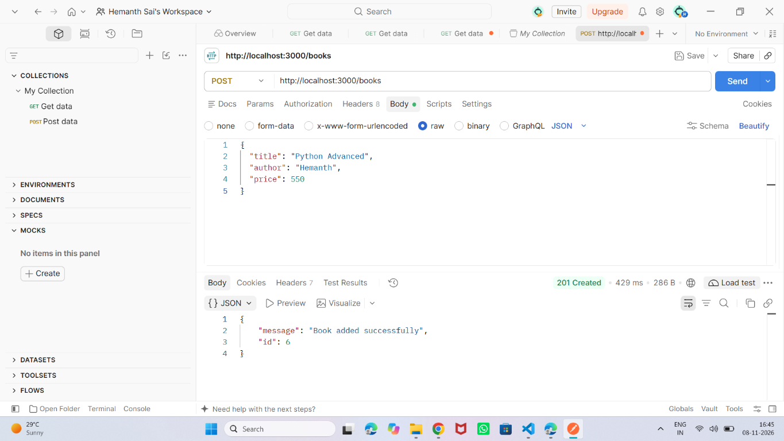
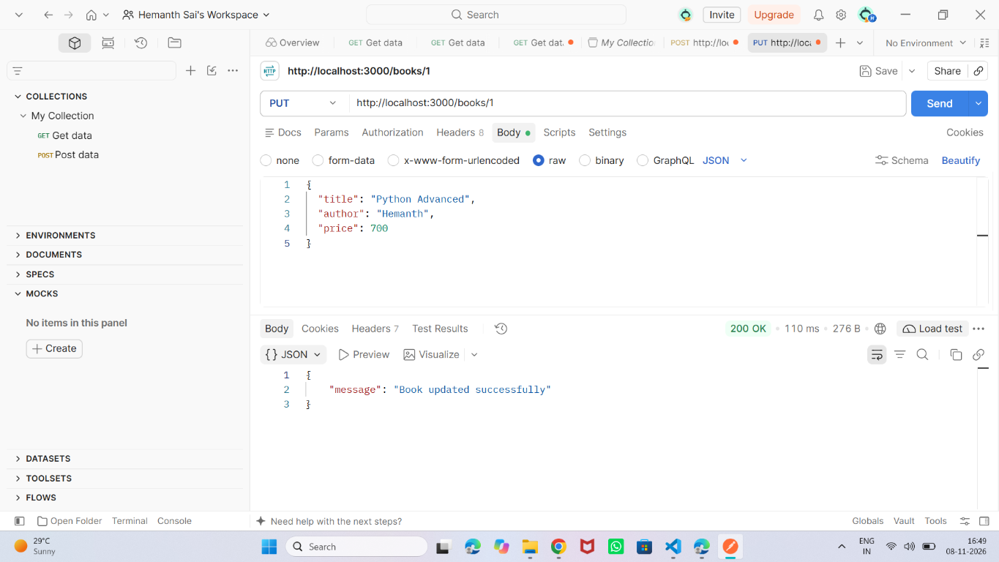
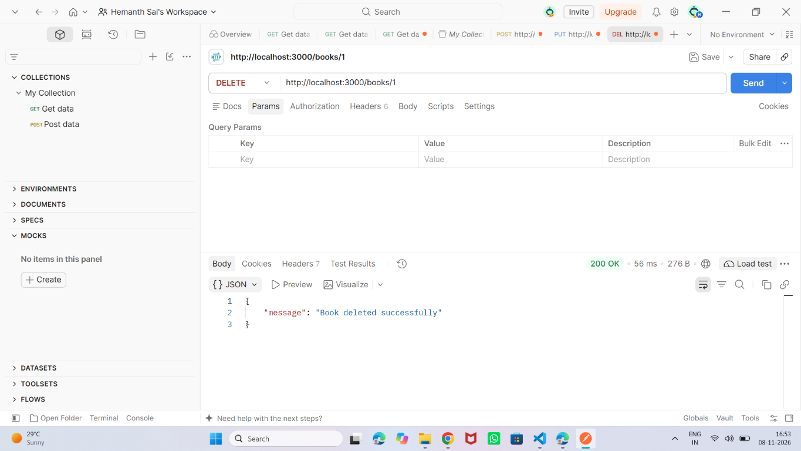
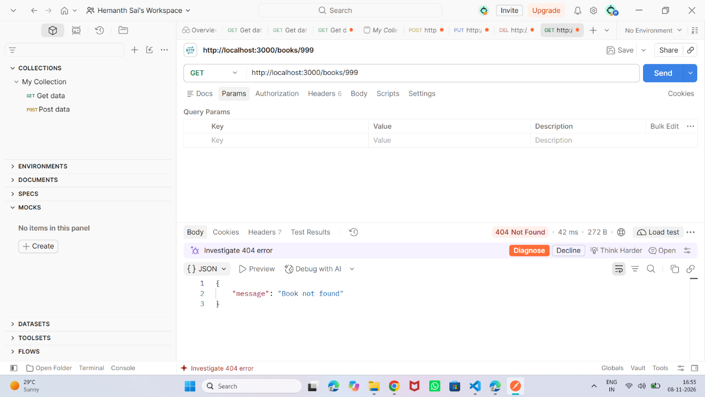
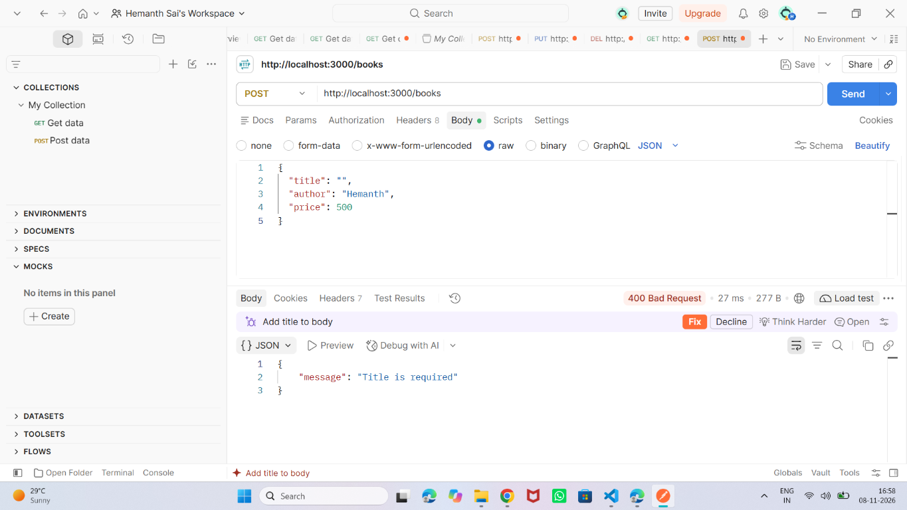
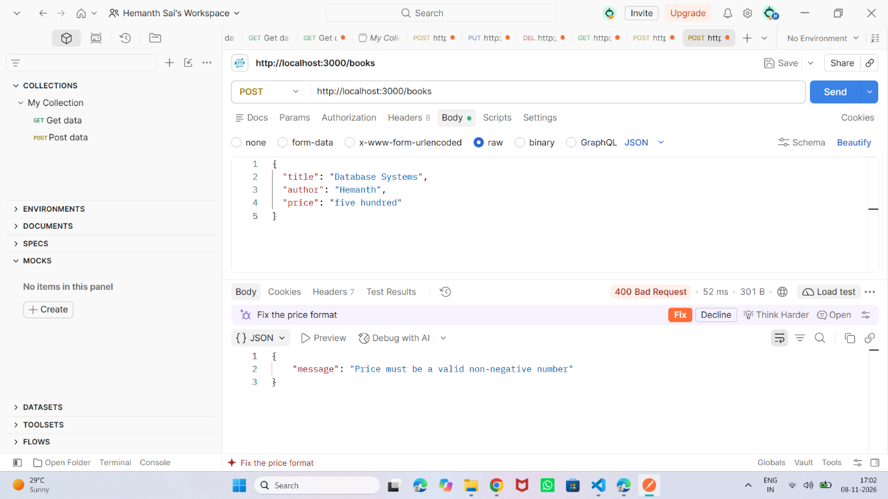
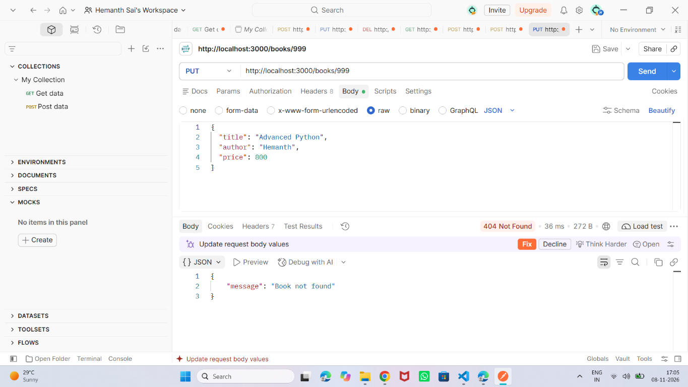

# Lab 3: REST API, Query Parameters, Validation and Debugging

## Student Details

- **Name:**Gummadidala Hemanth Venkata Sai
- **Registration Number:** 252U1R6088
- **Section:** CSE AIML-2B
- **Course:** Backend Development Fundamentals
- **Lab:** 03

## Project Description

This project implements a REST API for managing books using Node.js, Express.js and SQLite.

The API supports creating, retrieving, updating and deleting book records. It also includes query parameters, input validation, error handling and parameterized SQL queries.

## Technologies Used

- Node.js
- Express.js
- SQLite
- Postman
- dotenv

## Installation and Setup

1. Open the project folder in VS Code.
2. Open the terminal inside the `lab-03` folder.
3. Install the dependencies:

```bash
npm install
```

4. Configure the `.env` file:

```env
PORT=3000
DB_PATH=./books.db
```

5. Start the development server:

```bash
npm run dev
```

The API runs at:

`http://localhost:3000`

## API Endpoints

| Method | Endpoint | Description |
|---|---|---|
| GET | `/books` | Get all books |
| GET | `/books/:id` | Get a book by ID |
| POST | `/books` | Add a new book |
| PUT | `/books/:id` | Update a book |
| DELETE | `/books/:id` | Delete a book |

## Query Parameters

The GET `/books` endpoint supports:

- `search_q` – Search books by title.
- `order_by` – Sort using id, title, author or price.
- `order` – Sort in ASC or DESC order.
- `limit` – Set the number of records.
- `offset` – Skip records.
- `min_price` – Minimum book price.
- `max_price` – Maximum book price.

Example:

`http://localhost:3000/books?search_q=Python&order_by=price&order=ASC&limit=5&offset=0`

## Validation and Error Handling

- Returns 400 Bad Request for invalid input.
- Returns 404 Not Found when a book does not exist.
- Returns 500 Internal Server Error for server/database errors.
- Uses parameterized SQL queries to prevent SQL injection.

## Postman Screenshots

### 1. Get All Books


### 2. Get Book By ID


### 3. Add New Book


### 4. Update Book


### 5. Delete Book


### 6. Get Non-Existing Book


### 7. Invalid Book Details


### 8. Invalid Price


### 9. Update Non-Existing Book


### 10. Delete Non-Existing Book


## How to Run

```bash
npm install
npm run dev
```

## Security

- `.env` and database files are excluded using `.gitignore`.
- `node_modules` is not included in the GitHub repository.
- SQL queries use parameterized statements.

## Conclusion

This lab helped me understand how to build REST APIs using Express.js and SQLite. I learned how to use HTTP methods, query parameters, input validation, error handling and Postman for API testing.