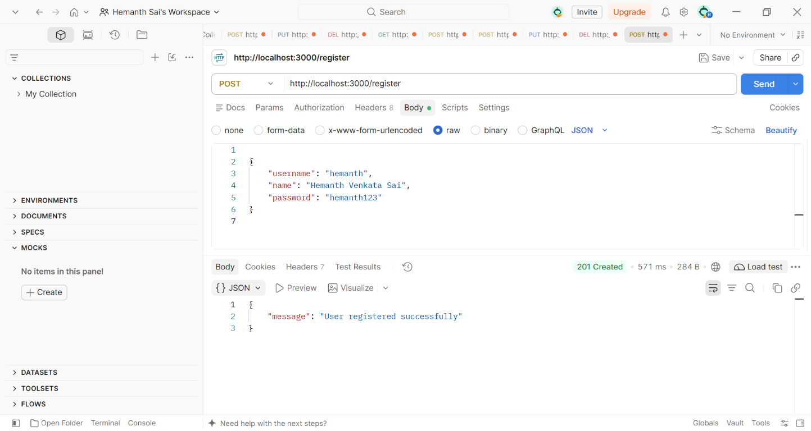
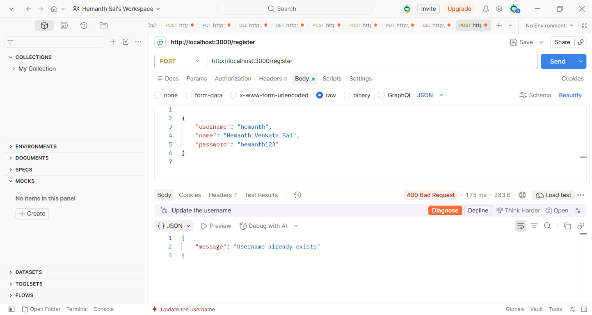
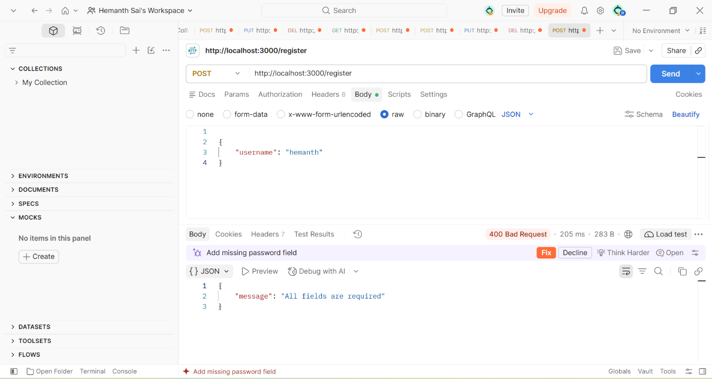
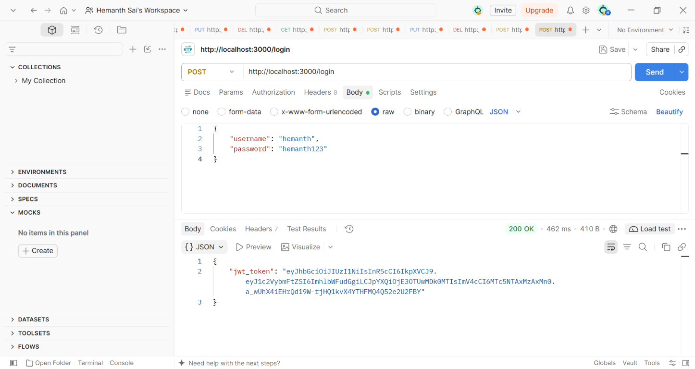
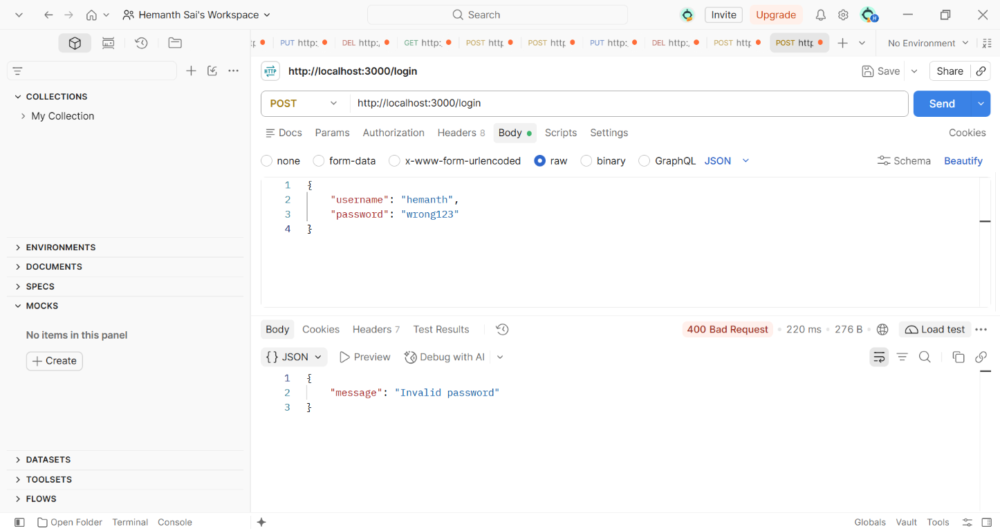
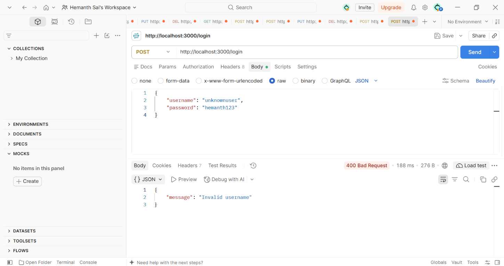
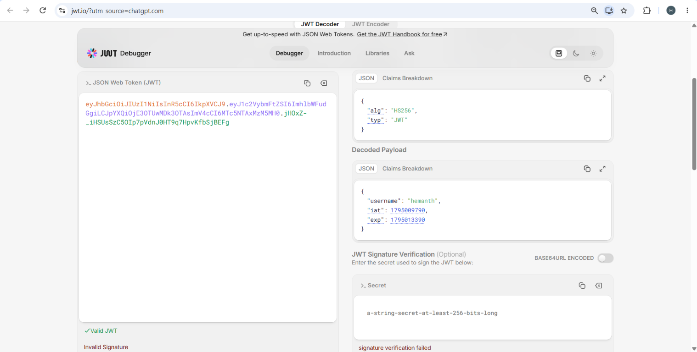
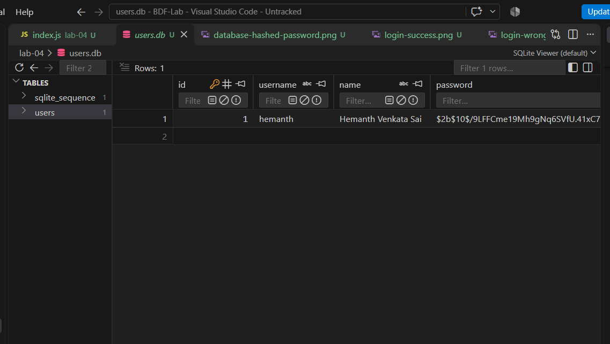

# Lab 4: Registration, Login and JWT

**Name:** Gummadidala Hemanth Venkata Sai  
**Registration Number:** 252U1R6088  
**Section:** CSE-AIML-2B

## Live Link

Deployment: Pending

## Objective

To implement user registration and login functionality using Node.js, Express.js, SQLite, bcrypt password hashing and JSON Web Tokens (JWT) for authentication.

## Technologies Used

- Node.js
- Express.js
- SQLite3
- bcrypt
- jsonwebtoken
- Postman
- Visual Studio Code

## How to Run the Project

**Step 1: Install dependencies**

```bash
npm install
```

**Step 2: Start the server**

```bash
node index.js
```

**Step 3: Server URL**

```text
http://localhost:3000
```

**Environment Variables:** No environment variables are required for this lab. The JWT secret is currently defined as a constant in the application code.

## API Endpoints

| Method | Endpoint | Description |
|---|---|---|
| POST | /register | Registers a new user with a hashed password. |
| POST | /login | Authenticates the user and returns a JWT token. |

## Screenshots

### 1. User Registration

**Successful Registration**



**Duplicate Username**



**Missing Registration Fields**



### 2. User Login

**Successful Login**



**Wrong Password**



**Unknown Username**



### 3. JWT Token Verification



### 4. Database Verification



## Notes: Problems Faced and Solutions

1. Faced difficulties while installing the required Node.js packages. Resolved them by installing the dependencies using npm.
2. Learned how to connect the Express application with an SQLite database.
3. Implemented bcrypt to securely hash user passwords before storing them.
4. Tested different registration and login scenarios using Postman.
5. Generated JWT tokens after successful login and decoded them using jwt.io to understand their structure.

## Conclusion

Successfully implemented user registration and login functionality using Node.js and Express.js. Passwords are stored as bcrypt hashes in the SQLite database, and JWT tokens are generated after successful authentication. Tested the API endpoints using Postman and verified the authentication functionality.
